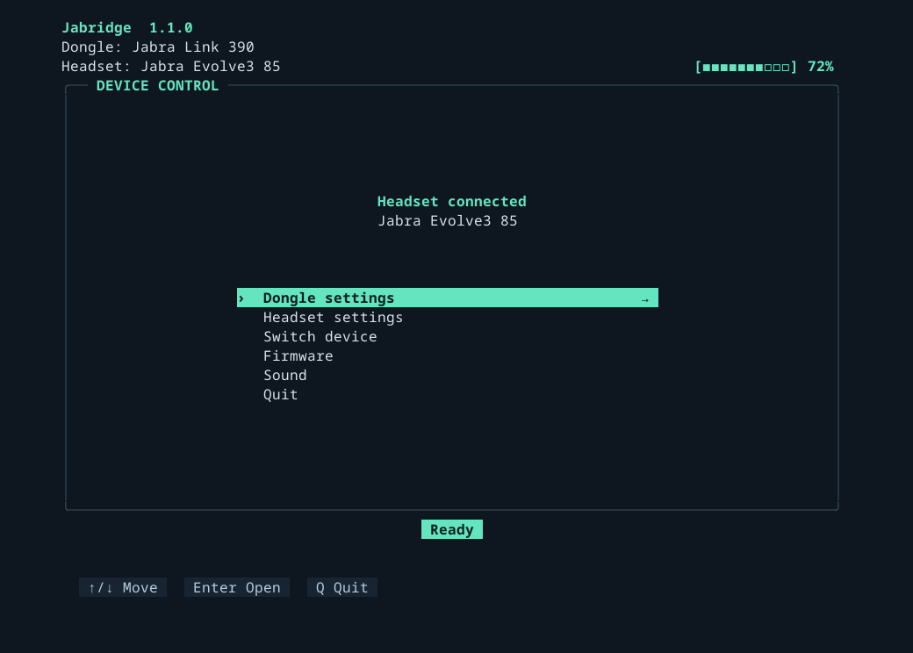
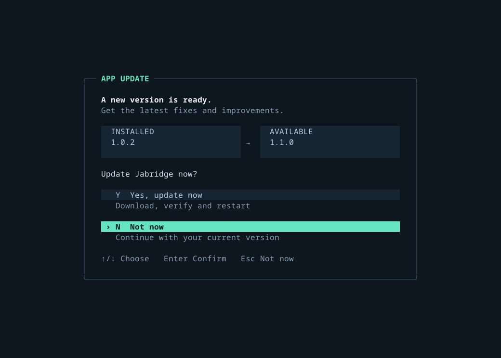

# Jabridge: Jabra Direct for Linux

Control Jabra headsets and dongles on Linux. Change settings, manage sound and update supported firmware.

Made by the community. This is not an official Jabra product.



*Example menu with sample data.*

## Start

[Download Jabridge](https://github.com/Watchdog0x/jabridge/releases/latest), extract it and open the folder in a terminal:

```sh
./jabridge setup
./jabridge
```

Follow the setup prompts. Use the arrows to move, Enter to choose and Q to go back.

## Update

Press Y when Jabridge offers an update, or run:

```sh
./jabridge update
```



*Older example update screen. No is selected by default.*

## Headset firmware

Open **Firmware**, choose your device and follow the steps. Keep it plugged in until the update finishes.

Support depends on your model. Evolve2 40 still has an [unresolved firmware problem](docs/FIRMWARE.md#known-limitation-evolve2-40-firmware).

## Experimental controls

Equalizer, noise button cycle and power saving can be changed on matching
firmware profiles. These controls have not been fully tested on hardware.
Link 380c `24c9` pairing features are off by default. These options still need
device tests. See the [optional test steps](docs/TEST_EVOLVE3_CONTROLS.md).

## Need help?

Save a debug report:

```sh
./jabridge debug --output jabridge-debug.txt
```

Check the file before sharing it. [Open an issue](https://github.com/Watchdog0x/jabridge/issues/new) and attach the report with your headset model and what went wrong.

## Package-managed builds

Package maintainers can [let their package manager handle updates and setup](docs/DEVELOPMENT.md#package-managed-builds).

## Thank you

Thanks to [am4c130d](https://github.com/am4c130d), [delacor](https://github.com/delacor), [Danfro](https://github.com/Danfro), [keydon](https://github.com/keydon), [zetneteork](https://github.com/zetneteork), [Atem18](https://github.com/Atem18) and everyone helping.

## More help

- [Commands and headset controls](docs/USAGE.md)
- [Tested devices and firmware recovery](docs/HARDWARE_TESTING.md)
- [Build from source and package options](docs/DEVELOPMENT.md)
- [Build your own interface](docs/IPC.md)

[License](LICENSE) · [Release notes](CHANGELOG.md)
